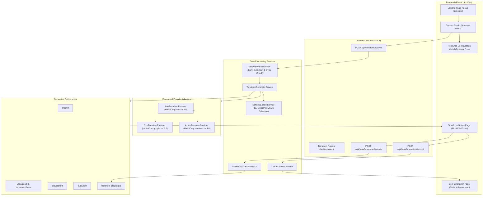

# TerraGen: Enterprise Multi-Cloud Visual Infrastructure Studio

A full-stack, visual Infrastructure-as-Code (IaC) studio designed to design, wire, validate, and generate production-grade, multi-file Terraform configurations across Amazon Web Services (AWS), Microsoft Azure, and Google Cloud Platform (GCP).

---

## Table of Contents

- [Overview](#overview)
- [Key Capabilities](#key-capabilities)
- [Architecture and Data Flow](#architecture-and-data-flow)
- [Comprehensive File and Directory Guide](#comprehensive-file-and-directory-guide)
  - [Root Level](#root-level)
  - [Backend Core Services and Providers](#backend-core-services-and-providers)
  - [Backend Schemas (127 Resources)](#backend-schemas-127-resources)
  - [Backend Route Handlers and Utilities](#backend-route-handlers-and-utilities)
  - [Backend Test Suites](#backend-test-suites)
  - [Frontend Architecture and Components](#frontend-architecture-and-components)
  - [Documentation and Architecture Records](#documentation-and-architecture-records)
- [Getting Started and Local Setup](#getting-started-and-local-setup)
  - [Prerequisites](#prerequisites)
  - [Backend Installation and Run](#backend-installation-and-run)
  - [Frontend Installation and Run](#frontend-installation-and-run)
  - [Automated Verification and Testing](#automated-verification-and-testing)
- [End-to-End User Guide](#end-to-end-user-guide)
- [Manual Operations and Recovery Guide](#manual-operations-and-recovery-guide)
  - [Manual Execution from Generated Files](#manual-execution-from-generated-files)
  - [Configuring Cloud Provider Credentials](#configuring-cloud-provider-credentials)
  - [Validating and Formatting HCL](#validating-and-formatting-hcl)
  - [Executing Plan and Apply](#executing-plan-and-apply)
  - [Troubleshooting Common Failures Manually](#troubleshooting-common-failures-manually)
- [Design Standards and Conventions](#design-standards-and-conventions)
- [License](#license)

---

## Overview

TerraGen transforms complex cloud infrastructure architecture into an interactive, visual, and secure engineering workflow. Rather than handwriting verbose HashiCorp Configuration Language (HCL) boilerplate, cloud architects and DevOps engineers can visually place infrastructure nodes onto an infinite canvas, connect input/output dependency ports, configure resource properties through dynamic, schema-driven forms, inspect generated multi-file configurations in a live code studio, project real-time cloud costs, and export a ready-to-deploy multi-file project.

The system is built with a decoupled provider architecture, supporting 127 verified cloud resources with runtime schema introspection, automatic security hardening, topological graph sorting, cycle detection, and zero-dependency ZIP archive creation.

---

## Key Capabilities

- Visual Infrastructure Canvas: A lightweight, pure SVG and HTML5 interactive canvas with fluid pan and zoom, node dragging, connector hit testing, bidirectional wire routing, and auto-snapping ports.
- Comprehensive Multi-Cloud Catalog (127 Resources):
  - AWS (50 Resources): Compute (EC2, ASG, Launch Template, EKS, ECS), Networking (VPC, Subnet, IGW, NAT, EIP, Route Table, Security Groups, ALB/NLB), Database (RDS, DynamoDB, ElastiCache, Redshift Serverless), Serverless & Messaging (Lambda, API Gateway v2, SQS, SNS, EventBridge, CloudWatch), Security & Identity (IAM Roles, Policies, Instance Profiles, KMS, Secrets Manager, CloudTrail, Budgets), and Storage (S3 with bucket versioning).
  - Azure (35 Resources): Core (Resource Groups), Networking (VNet, Subnet, NSG, Public IP, NIC, NAT Gateway, Azure LB, Private Endpoint, DNS Zones), Compute (Linux VM, Windows VM, AKS, AKS Node Pools, Container Registry ACR), Database (MSSQL Server, MSSQL Database, Cosmos DB, PostgreSQL Flexible Server, Redis Cache), Serverless (Service Plan, Linux Function App, Linux Web App), Security (Key Vault, Key Vault Secret, Access Policies, User Assigned Identity), Messaging & Storage (Storage Account, Blob Container, Service Bus Namespace, Service Bus Queue), and Observability (Log Analytics Workspace, Application Insights).
  - GCP (42 Resources): Full Application and Network Load Balancing Suite (Global Forwarding Rule, Regional Forwarding Rule, Target HTTP/HTTPS Proxy, URL Map, Global Backend Service, Regional Backend Service, Health Checks, Serverless NEG), Kubernetes Engine (GKE Cluster, GKE Node Pool), Compute (Compute Instance, Instance Template, Instance Group Manager), Serverless (Cloud Run v2, Cloud Functions v2, Artifact Registry), Database (Cloud SQL Instance, Cloud SQL Database, BigQuery Dataset, BigQuery Table, Memorystore Redis), Networking (VPC Network, Subnetwork, Cloud Router, Cloud NAT, Firewall Rules, Global IP, Regional IP, Cloud DNS), Security & Monitoring (IAM Service Account, Project IAM Member, Secret Manager, Cloud KMS, Cloud Logging Sinks, Monitoring Alert Policies), and Storage & Messaging (Cloud Storage Bucket, Pub/Sub Topics, Pub/Sub Subscriptions).
- Enterprise Multi-File Project Layout: Automatically emits clean, decoupled project files conforming to HashiCorp best practices:
  - `main.tf`: Topologically ordered resource declarations with resolved cross-resource references.
  - `variables.tf`: Parameterized root input variables (`environment`, `azure_location`, `aws_region`, `gcp_project_id`, `gcp_region`).
  - `outputs.tf`: Collision-free, structured outputs (IDs, ARNs, FQDNs, endpoints, IPs, URIs).
  - `providers.tf`: Root version constraints (`required_version = ">= 1.5.0"`) and hardened provider definitions with baseline security configurations.
  - `terraform.tfvars`: Sample production assignment values for variables.
- Dynamic Runtime Schema Hardening: Injects enterprise security standards on the fly by inspecting resource schema definitions at runtime (no hardcoding in the generator):
  - TLS 1.2 minimum enforcement (`min_tls_version = "TLS1_2"` / `minimum_tls_version = "1.2"`).
  - Centralized audit tagging and labeling (`Environment`, `ManagedBy = "Terraform"`).
  - Storage encryption at rest and automated minor upgrades.
  - Uniform bucket-level access controls and soft-delete retention safeguards.
- Directed Acyclic Graph (DAG) Engine: Kahn's topological sort algorithm resolves correct dependency provisioning orders and identifies circular dependencies before any HCL is written.
- In-Place HCL Studio: Full-screen multi-file code viewer with in-place text editing, synchronized line numbering, reset controls, clipboard copy, and single-file downloads.
- Multi-Cloud Cost Estimator: Real-time calculation of running infrastructure expenses across AWS, Azure, and GCP, supporting custom operational durations (1 to 3,650 days) with itemized cost breakdowns and architectural optimization insights.
- Zero-Dependency ZIP Export: In-memory streaming archive generator (`backend/src/utils/zip.util.js`) implementing the PKZip 2.0 specification with zero external dependencies.
- Structured API Gateway and Response Verification: Strict Clean Architecture and SecOps boundary enforcement. All frontend HTTP interactions flow through a structured client (`frontend/src/services/api.service.js`) with declarative runtime response schema verification (`verifyApiResponse`), normalized domain errors (`ApiError`, `ApiValidationError`, `NetworkError`), timeout controls, and security headers (`X-Content-Type-Options: nosniff`, `X-Frame-Options: DENY`, `Referrer-Policy: strict-origin-when-cross-origin`).

---

## Architecture and Data Flow



---

## Comprehensive File and Directory Guide

This section provides a complete inventory of every file and folder in the repository, explaining its location and specific operational task.

### Root Level

| File / Path | Task and Responsibility |
| :--- | :--- |
| `package.json` | Top-level project descriptor with monorepo utility scripts (`npm run test`, `npm run build`). |
| `.gitignore` | Excludes `node_modules/`, build artifacts (`dist/`), local environment files (`.env`), and Terraform state directories (`.terraform/`). |
| `README.md` | Primary architectural reference, onboarding manual, directory guide, and recovery procedures. |
| `generated/` | Output directory where generated multi-file Terraform files (`main.tf`, `variables.tf`, `outputs.tf`, `providers.tf`, `terraform.tfvars`) are written during code generation. |

### Backend Core Services and Providers

Located in `backend/src/services/` and `backend/src/services/terraform-providers/`:

| File Path | Task and Responsibility |
| :--- | :--- |
| `backend/src/app.js` | Express 5 application entry point. Configures JSON body parser, CORS, route middleware mounts, and centralized error handling on port 5000. |
| `backend/src/services/terraform-generator.services.js` | Core Terraform generation service. Orchestrates DAG resolution, schema validation, dynamic on-the-go hardening, file separation, and disk persistence. |
| `backend/src/services/graph-resolver.service.js` | Directed Acyclic Graph (DAG) resolver. Executes Kahn's algorithm for topological sorting, detects circular dependencies, and builds reference maps. |
| `backend/src/services/schema-loader.service.js` | Discovers and indexes 127 JSON schemas across AWS, Azure, and GCP. Handles version resolution and metadata lookup. |
| `backend/src/services/serializer.service.js` | Low-level HCL serializer. Translates internal JavaScript configuration dictionaries into clean, unquoted, indented Terraform HCL blocks. |
| `backend/src/services/nested-block.service.js` | Specialised serializer for complex nested HCL blocks (e.g. `target_tracking_configuration`, `ingress`, `egress`, `features`). |
| `backend/src/services/validation.service.js` | Validates resource field constraints, coerced data types, and required inputs against resource schemas. |
| `backend/src/services/aws-name-validator.service.js` | Cloud-specific resource naming validation (S3 DNS-compliant bucket rules, IAM regex checks, RDS identifiers, SQS FIFO naming). |
| `backend/src/services/cost-estimator.service.js` | Multi-cloud pricing calculation engine. Projects hourly, monthly, and retention timeline costs for provisioned compute, databases, networking, and storage. |
| `backend/src/services/cleanup.service.js` | Utility service for cleaning up temporary files and generated artifacts safely. |
| `backend/src/services/terraform-providers/base.provider.js` | Abstract base class establishing contracts for `getProvidersTf()`, `getVariablesTf()`, `getOutputsTf()`, `getTfVars()`, and standard enterprise outputs. |
| `backend/src/services/terraform-providers/aws.provider.js` | AWS provider strategy adapter. Manages HashiCorp AWS `~> 5.0` provider configuration, `default_tags`, region variables, and 50 AWS output mappings. |
| `backend/src/services/terraform-providers/azure.provider.js` | Azure provider strategy adapter. Manages HashiCorp azurerm `~> 4.0` provider configuration, hardened `features {}` block, location variables, and 35 Azure output mappings. |
| `backend/src/services/terraform-providers/gcp.provider.js` | GCP provider strategy adapter. Manages HashiCorp google `~> 6.0` provider configuration, `default_labels`, project/region variables, and 42 GCP output mappings. |
| `backend/src/services/terraform-providers/index.js` | Provider factory registry exposing `getTerraformProvider(providerKey)` singleton access. |

### Backend Live Cloud Providers

Located in `backend/src/providers/`:

| File Path | Task and Responsibility |
| :--- | :--- |
| `backend/src/providers/aws/ec2.provider.js` | Live AWS EC2 SDK integration for querying real instance types, AMIs, and VPCs. Falls back to curated offline catalog when credentials are absent. |
| `backend/src/providers/aws/iam.provider.js` | Provides offline and live catalogs of AWS Managed Policies and Service Trust Principals for IAM role configuration without credential blocks. |
| `backend/src/providers/aws/redshift-serverless.provider.js` | Live AWS Redshift Serverless integration for namespaces and workgroups. |
| `backend/src/providers/gcp/compute.provider.js` | Live Google Cloud Compute Engine SDK integration with credential-free offline fallback for machine types and zones. |

### Backend Schemas (127 Resources)

Located in `backend/src/schemas/`:

| Directory | Count | Key Resources Covered |
| :--- | :--- | :--- |
| `backend/src/schemas/aws/*/5.0/base.json` | 50 | EC2, VPC, Subnet, Internet Gateway, NAT Gateway, EIP, Route Table, Security Group, ALB, ALB Listener, Target Group, RDS Instance, Subnet Group, Parameter Group, DynamoDB, ElastiCache, Redshift Serverless (Namespace/Workgroup), Lambda, API Gateway v2, SQS, SNS, EventBridge (Rule/Target), CloudWatch (Alarms/Logs), S3, S3 Versioning, IAM (Role, Policy, Attachment, Profile), KMS (Key, Alias), Route53 (Zone, Record), CloudFront, EKS, EKS Node Group, ECS (Cluster, Service, Task Def), Auto Scaling (Group, Policy), Launch Template, Secrets Manager, CloudTrail, Budgets. |
| `backend/src/schemas/azure/*/{3.0,4.0}/base.json` | 35 | Resource Group, VNet, Subnet, NSG, Subnet-NSG Association, Public IP, NIC, NAT Gateway, Azure LB, Private Endpoint, DNS Zone, DNS A Record, Linux VM, Windows VM, AKS, AKS Node Pool, ACR, MSSQL Server, MSSQL Database, Cosmos DB, PostgreSQL Flexible Server, Redis Cache, Service Plan, Linux Function App, Linux Web App, Key Vault, Key Vault Secret, Key Vault Access Policy, User Assigned Identity, Storage Account, Blob Container, Service Bus (Namespace, Queue), Log Analytics Workspace, Application Insights. |
| `backend/src/schemas/gcp/*/{5.0,6.0}/base.json` | 42 | Global Forwarding Rule, Regional Forwarding Rule, Target HTTP Proxy, Target HTTPS Proxy, URL Map, Global Backend Service, Regional Backend Service, Health Check, Serverless NEG, GKE Cluster, GKE Node Pool, Compute Instance, Instance Template, Instance Group Manager, Cloud Run v2, Cloud Functions v2, Artifact Registry, Cloud SQL Instance, Cloud SQL Database, BigQuery Dataset, BigQuery Table, Redis Instance, VPC Network, Subnetwork, Cloud Router, Cloud NAT, Firewall Rules, Compute Address, Global Address, Cloud DNS (Zone, Record), IAM Service Account, Project IAM Member, Secret Manager (Secret, Version), Cloud KMS (KeyRing, CryptoKey), Logging Sink, Monitoring Alert Policy, Storage Bucket, Pub/Sub (Topic, Subscription). |

### Backend Route Handlers and Utilities

Located in `backend/src/routes/` and `backend/src/utils/`:

| File Path | Task and Responsibility |
| :--- | :--- |
| `backend/src/routes/terraform.routes.js` | Exposes endpoints for graph generation (`POST /api/terraform/canvas`), cost estimation (`POST /api/terraform/estimate-cost`), and ZIP packaging (`POST /api/terraform/download-zip`). |
| `backend/src/routes/schema.routes.js` | Exposes schema discovery endpoints (`GET /api/schema/providers`, `GET /api/schema/:provider/:resourceId`). |
| `backend/src/routes/resource.routes.js` | Exposes resource listing and categorization endpoints. |
| `backend/src/routes/dynamic.routes.js` | Exposes endpoints for dynamic dropdown choices with graceful offline catalog degradation. |
| `backend/src/routes/dependency.routes.js` | Exposes endpoints for inspecting cross-resource relationships and valid connections. |
| `backend/src/routes/validation.routes.js` | Exposes endpoints for real-time field constraint validation. |
| `backend/src/utils/api-response.util.js` | Standardized API response utility enforcing Clean Architecture envelopes (`ApiResponse.success`, `ApiResponse.error`), timestamps, and SecOps error sanitization. |
| `backend/src/utils/zip.util.js` | Standalone, zero-dependency in-memory ZIP archive generator adhering to standard PKZip specification. |
| `backend/src/utils/naming.util.js` | Normalizes and sanitizes user-provided resource identifiers into valid HCL labels. |
| `backend/src/utils/error.util.js` | Structured application error utility with HTTP status codes and contextual messages. |

### Backend Test Suites

Located in `backend/test/`:

| Test File | Verification Scope |
| :--- | :--- |
| `backend/test/schema-and-generator.test.js` | Validates loading of all 127 schemas, schema metadata integrity, and basic HCL generation. |
| `backend/test/graph-generator.test.js` | Validates topological sorting, reference wiring, cycle detection, multi-cloud complex DAGs, and GCP LB chains. |
| `backend/test/canvas-route.test.js` | Validates Express route handling for `/api/terraform/canvas` and error handling for empty canvas graphs. |
| `backend/test/connection-resolver.test.js` | Validates port connection compatibility, locking mechanisms, and self-connection rejection. |
| `backend/test/aws-name-validator.test.js` | Tests AWS S3 naming rules, IAM policy naming, RDS identifiers, and offline catalogs. |
| `backend/test/cost-estimator.test.js` | Validates multi-cloud pricing formulas, duration scaling, and raw HCL fallback estimation. |
| `backend/test/production-terraform.test.js` | Validates production features across Azure, AWS, and GCP (provider blocks, input variables, outputs, hardening). |
| `backend/test/zip.test.js` | Validates byte-level structure and integrity of the zero-dependency in-memory ZIP utility. |
| `backend/test/api-response.test.js` | Validates structured API response envelopes, metadata propagation, and standardized error codes. |

### Frontend Architecture and Components

Located in `frontend/src/`:

| File Path | Task and Responsibility |
| :--- | :--- |
| `frontend/src/services/api.service.js` | Structured API Client and Response Verifier. Replaces raw HTTP calls with type-checked, schema-verified domain methods, timeout controls, and normalized error classes. |
| `frontend/src/App.jsx` | Root state manager and view router. Manages current screen (`landing`, `canvas`, `output`, `cost`), active provider, canvas nodes/edges, and generated Terraform files. |
| `frontend/src/main.jsx` | React 19 application bootstrap with `ThemeProvider`. |
| `frontend/src/index.css` | Comprehensive design system CSS variables, dark/light themes, typography, and utility classes. |
| `frontend/src/components/landing/LandingPage.jsx` | Modern landing interface featuring provider selection cards (AWS, Azure, GCP), capability overview, and workflow steps. Strictly solid colors. |
| `frontend/src/components/canvas/CanvasStudio.jsx` | Core visual canvas studio. Manages pan, zoom, node positioning, SVG rendering, wire dragging, and generation actions. |
| `frontend/src/components/canvas/CanvasNode.jsx` | High-end canvas node ($224 \times 60\text{px}$) with cloud brand badge, title, instance name, connection ports, and action menu. |
| `frontend/src/components/canvas/ConnectionWires.jsx` | Renders dynamic SVG cubic bezier wires connecting source output ports to target input ports. |
| `frontend/src/components/canvas/ResourceSidebar.jsx` | Filterable palette displaying available cloud resources organized by category. |
| `frontend/src/components/canvas/ResourceConfigModal.jsx` | Modal dialog wrapping `DynamicForm` for configuring resource parameters. |
| `frontend/src/components/canvas/TerraformOutputPage.jsx` | Dedicated multi-file code studio with file tab switching, in-place HCL editor, clipboard tools, ZIP download, and DAG sequence card. |
| `frontend/src/components/cost/CostEstimationPage.jsx` | Dedicated cost calculator with interactive duration slider (1 to 3,650 days), preset buttons, KPI cards, and itemized resource breakdowns. |
| `frontend/src/components/DynamicForm.jsx` | Schema-driven form engine supporting all primitives, complex nested blocks, conditional visibility, and inline validation. |
| `frontend/src/components/DependencySection.jsx` | Manual connection manager allowing users to review and bind references directly. |
| `frontend/src/components/Navbar.jsx` | Top navigation bar with breadcrumbs and dark/light mode toggle. |
| `frontend/src/components/ui/Icons.jsx` | SVG icon library containing cloud provider logos, official Terraform SVG logo, and UI action icons. |
| `frontend/src/context/ThemeContext.jsx` | Context provider managing light/dark theme switching with `localStorage` persistence. |
| `frontend/src/hooks/useCanvasKeyboard.js` | Keyboard shortcut hook for deleting selected elements, undoing actions, and navigation. |
| `frontend/src/utils/connectionResolver.js` | Client-side validation ensuring valid port connection pairings. |
| `frontend/src/utils/awsNameValidator.js` | Client-side name constraint validation for AWS resources. |
| `frontend/src/config/providers.jsx` | Cloud provider metadata, branding colors, and resource counts. |

### Documentation and Architecture Records

Located in `docs/`:

| File Path | Task and Responsibility |
| :--- | :--- |
| `docs/architecture/ARCHITECTURE.md` | Architectural principles, component boundaries, schema structures, and data models. |
| `docs/decisions/0001-schema-versioning-and-generic-form-architecture.md` | Architectural Decision Record (ADR) establishing multi-version JSON schemas and generic form generation. |
| `docs/error-solving/understood-errors.md` | Living knowledge base of known failure modes, error patterns, and preventive solutions. |
| `docs/short-term-plan/CONTINUITY.md` | Session continuity ledger tracking project goals, decisions, progress, and working sets. |

---

## Getting Started and Local Setup

### Prerequisites

- Node.js: Version 18.0.0 or higher (Node 20+ LTS recommended).
- npm: Version 9.0.0 or higher.
- Terraform CLI (Optional, for manual local verification): Version 1.5.0 or higher.

### Backend Installation and Run

1. Navigate to the backend directory:
   ```bash
   cd backend
   ```
2. Install dependencies:
   ```bash
   npm install
   ```
3. (Optional) Create a local `.env` file in `backend/`:
   ```env
   PORT=5000
   ```
4. Start the backend development server:
   ```bash
   npm run dev
   ```
   The backend API will start on `http://localhost:5000`.

### Frontend Installation and Run

1. In a separate terminal, navigate to the frontend directory:
   ```bash
   cd frontend
   ```
2. Install dependencies:
   ```bash
   npm install
   ```
3. Start the Vite development server:
   ```bash
   npm run dev
   ```
4. Open your browser and navigate to the local Vite URL (typically `http://localhost:5173`).

### Automated Verification and Testing

Execute all automated verification suites:

1. Run the entire backend test suite (8 test suites, 100% passing):
   ```bash
   npm --prefix backend test
   ```
2. Verify production frontend build:
   ```bash
   npm --prefix frontend run build
   ```
3. Verify Terraform syntax on generated configurations:
   ```bash
   terraform fmt -check generated
   ```

---

## End-to-End User Guide

Follow these steps to build, validate, and export cloud infrastructure:

### 1. Select Cloud Provider
On the home landing page, select your target cloud provider:
- AWS (50 Resources)
- Azure (35 Resources)
- Google Cloud (42 Resources)

Click **Open Studio** to transition directly into the Canvas Studio.

### 2. Design Visual Topology on the Canvas
- Drag Resources: Use the left sidebar palette to search and drag resources (e.g. VPC, Subnet, Virtual Machine, Database) onto the canvas.
- Connect Wires: Click the connector port on a parent resource and drag a wire to the input port of a child resource (for example, connect a Subnet output to an EC2 or VM input). The canvas enforces valid connection pairings automatically.
- Position and Inspect: Drag nodes to arrange your architecture visually. Pan by clicking and dragging empty canvas space, and zoom using the mouse wheel or top control buttons.

### 3. Configure Resource Parameters
- Click the **Configure (Gear)** icon on any canvas node to open the configuration modal.
- Fill in required fields (such as resource name, CIDR blocks, machine sizes, or retention days).
- Notice that attributes connected via wires are automatically locked and referenced to the upstream dependency.
- Click **Apply & Save Configuration**.

### 4. Generate Multi-File Terraform
- Click the **Generate Terraform** button in the top right header.
- The platform resolves the DAG provisioning sequence, applies dynamic security hardening, separates code into 5 standard files, and redirects to the **Generated Terraform Page**.

### 5. Review and Edit Code In-Place
- Switch between file tabs (`main.tf`, `variables.tf`, `outputs.tf`, `providers.tf`, `terraform.tfvars`) to inspect the modular structure.
- Click **Edit [filename]** to modify any file directly in the integrated editor. Pressing Tab inserts clean 2-space indentation.
- Modified files receive an indicator badge. Click **Done Editing** to commit changes, or **Reset** to revert back to the auto-generated HCL.

### 6. Estimate Cloud Costs
- Click **Estimate Cloud Cost** to open the real-time cost calculator.
- Adjust the operational duration slider (1 to 3,650 days) or choose preset durations (7, 30, 90, 365 days).
- Review itemized cost tables and architectural cost optimization tips.

### 7. Export Project
- Single File: Click **Download [filename]** to download any active file individually.
- Clipboard: Click **Copy [filename]** or **Copy All** to copy configurations directly.
- Full Project ZIP: Click **Download ZIP** to receive `terraform-project.zip` containing all 5 ready-to-deploy files.

---

## Manual Operations and Recovery Guide

If the web application is unreachable, network connectivity is interrupted, or an automated action fails, you can perform every step manually from the command line using the generated configuration files.

### Manual Execution from Generated Files

When the generator runs, it writes all project files to the `generated/` directory in the repository root:
```
generated/
├── main.tf
├── variables.tf
├── outputs.tf
├── providers.tf
└── terraform.tfvars
```
If you downloaded the project via ZIP, extract the archive into a dedicated directory and navigate to it in your terminal:
```bash
cd generated
```

### Configuring Cloud Provider Credentials

Before running Terraform commands, configure authentication for your chosen cloud provider:

#### AWS Credentials
Set standard environment variables or configure your AWS CLI profile:
```bash
# Option 1: Environment Variables
export AWS_ACCESS_KEY_ID="your-access-key-id"
export AWS_SECRET_ACCESS_KEY="your-secret-access-key"
export AWS_REGION="us-east-1"

# Option 2: AWS CLI Profile
aws configure
```

#### Azure Credentials
Authenticate using Azure CLI or service principal environment variables:
```bash
# Option 1: Azure CLI Interactive Login
az login
az account set --subscription "your-subscription-id"

# Option 2: Service Principal Environment Variables
export ARM_CLIENT_ID="your-service-principal-app-id"
export ARM_CLIENT_SECRET="your-service-principal-password"
export ARM_TENANT_ID="your-tenant-id"
export ARM_SUBSCRIPTION_ID="your-subscription-id"
```

#### Google Cloud Credentials
Authenticate using Google Cloud SDK application default credentials:
```bash
# Option 1: Application Default Credentials
gcloud auth application-default login

# Option 2: Service Account Key File
export GOOGLE_APPLICATION_CREDENTIALS="/path/to/service-account-key.json"
export GCP_PROJECT_ID="your-project-id"
```

### Validating and Formatting HCL

Run these commands inside the `generated/` directory to inspect and validate your configuration before deploying:

1. Initialize Provider Plugins:
   ```bash
   terraform init -upgrade
   ```
   This downloads the required official provider binaries (e.g. `hashicorp/aws`, `hashicorp/azurerm`, `hashicorp/google`).

2. Enforce Canonical Formatting:
   ```bash
   terraform fmt -diff
   ```
   Formats all `.tf` files to HashiCorp standard spacing and alignment.

3. Execute Syntax and Schema Validation:
   ```bash
   terraform validate
   ```
   Verifies that resource blocks, attribute types, and dependency references conform to provider specifications. You should receive:
   `Success! The configuration is valid.`

### Executing Plan and Apply

1. Review and Modify Input Variables:
   Open `terraform.tfvars` in your text editor and review the variable values:
   ```hcl
   environment    = "production"
   aws_region     = "us-east-1"
   # azure_location = "eastus"
   # gcp_project_id = "my-sample-project-id"
   ```
   You can override any variable at runtime using `-var`:
   ```bash
   terraform plan -var="environment=staging"
   ```

2. Generate a Dry-Run Execution Plan:
   ```bash
   terraform plan -out=tfplan
   ```
   Inspect the output carefully to confirm which resources will be created, updated, or destroyed.

3. Provision Infrastructure:
   ```bash
   terraform apply tfplan
   ```

4. Inspect Outputs:
   After successful provisioning, view generated endpoints and IDs:
   ```bash
   terraform output
   ```

5. Clean Teardown:
   When infrastructure is no longer needed, tear it down cleanly:
   ```bash
   terraform destroy
   ```

---

### Troubleshooting Common Failures Manually

#### 1. Cycle Detected in Graph
- Symptom: Error message stating `Error: Cycle: aws_subnet.subnet_b, aws_route_table.rt_a`.
- Cause: Two resources reference each other directly or indirectly, forming a circular dependency.
- Manual Fix:
  1. Open `main.tf`.
  2. Inspect the resource blocks flagged in the cycle message.
  3. Locate the mutual reference attribute (for example, a route table pointing to a subnet while the subnet references the same route table).
  4. Break the cycle by extracting the relationship into an association resource (e.g., `aws_route_table_association`) or replacing one hardcoded reference.

#### 2. Missing Required Attribute Error
- Symptom: `terraform validate` returns `The argument "xyz" is required, but no definition was found.`
- Cause: A required property was not filled in the visual form.
- Manual Fix:
  1. Open the corresponding schema in `backend/src/schemas/<provider>/<resource>/<version>/base.json` to find the exact attribute name and type.
  2. Open `main.tf`, locate the resource block, and add the missing attribute manually:
     ```hcl
     resource "azurerm_storage_account" "storage_main" {
       name                     = "mystorageacctprod"
       resource_group_name      = azurerm_resource_group.rg_main.name
       location                 = var.azure_location
       account_tier             = "Standard"
       account_replication_type = "LRS"
     }
     ```
  3. Re-run `terraform validate`.

#### 3. Azure Provider Authentication or Feature Block Errors
- Symptom: `Error building ARM Config: Authenticating using the Azure CLI is only supported as a User.` or `The provider provider.azurerm does not support resource types...`
- Manual Fix:
  1. Check `providers.tf` and ensure the `features {}` block is present:
     ```hcl
     provider "azurerm" {
       features {
         resource_group {
           prevent_deletion_if_contains_resources = false
         }
       }
     }
     ```
  2. Verify your subscription ID:
     ```bash
     az account show --query id -o tsv
     ```
  3. Pass the subscription ID directly in `providers.tf` or export `ARM_SUBSCRIPTION_ID`.

#### 4. GCP Quota or API Not Enabled
- Symptom: `Error 403: Compute Engine API has not been used in project ... before or it is disabled.`
- Manual Fix:
  1. Enable the required API via Google Cloud CLI:
     ```bash
     gcloud services enable compute.googleapis.com --project=your-project-id
     gcloud services enable container.googleapis.com --project=your-project-id
     gcloud services enable sqladmin.googleapis.com --project=your-project-id
     ```
  2. Re-run `terraform apply tfplan`.

#### 5. Terraform State Lock Errors
- Symptom: `Error: Error acquiring the state lock: ConditionalCheckFailedException...`
- Manual Fix:
  1. Retrieve the Lock ID shown in the error output.
  2. Run the manual unlock command (ensure no other team member is actively applying):
     ```bash
     terraform force-unlock <LOCK-ID>
     ```

---

## Design Standards and Conventions

- Zero Emoji Policy: In accordance with production engineering standards, all code, user documentation, commit messages, tests, and user interfaces strictly enforce zero emojis.
- Solid Color Philosophy: The user interface uses eye-soothing, high-contrast solid backgrounds (`#FAF9F6` / `#F5F6F8` in light mode, `#090A0D` / `#0B0F17` in dark mode) with zero distracting gradients.
- Typography: Uses `Plus Jakarta Sans` for clean body readability, `Space Grotesk` for titles and headings, and `JetBrains Mono` for code, metrics, and line numbers.

---

## License

Distributed under the **ISC License**.
