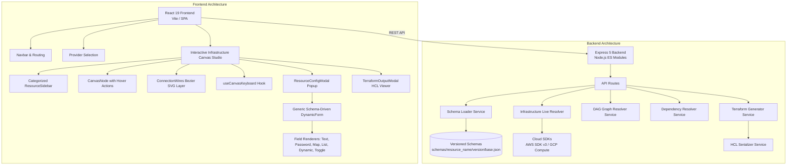

# System Architecture & Technical Specifications

## 1. System Overview
Auto Terraform Generator is a full-stack platform designed to generate production-ready, validated Terraform (HCL) configurations with automatic dependency resolution, topological DAG sorting, and visual infrastructure canvas modeling.



## 2. Directory Structure
```
Auto_terraform_generator/
├── backend/
│   ├── src/
│   │   ├── app.js                          # Express 5 entry point
│   │   ├── providers/                      # Live cloud SDK introspection
│   │   ├── routes/                         # Express REST route controllers
│   │   ├── schemas/                        # Clean versioned schemas
│   │   │   ├── <resource_name>/
│   │   │   │   ├── 5.0/base.json
│   │   │   │   └── ...
│   │   ├── services/                       # Core domain business logic
│   │   │   ├── schema-loader.service.js    # Schema indexer, category derivation & version resolver
│   │   │   ├── graph-resolver.service.js   # Kahn's DAG topological sort & ref mapping
│   │   │   ├── terraform-generator.services.js # HCL AST generator & multi-resource emitter
│   │   │   ├── dependency-resolver.service.js  # Inline dependency resolver
│   │   │   └── serializer.service.js       # HCL serialization
│   │   └── utils/
│   ├── test/                               # Comprehensive automated test suites
│   └── package.json
├── frontend/
│   ├── src/
│   │   ├── components/
│   │   │   ├── canvas/
│   │   │   │   ├── CanvasStudio.jsx        # Main Canvas studio coordinator & starter templates
│   │   │   │   ├── CanvasNode.jsx          # Resource node with hover action toolbar
│   │   │   │   ├── ConnectionWires.jsx     # Bezier curve SVG wires layer
│   │   │   │   ├── ResourceSidebar.jsx     # Draggable categorized resource palette
│   │   │   │   ├── ResourceConfigModal.jsx # Popup settings modal with glassmorphism
│   │   │   │   └── TerraformOutputModal.jsx# HCL preview & download dialog
│   │   │   ├── ui/
│   │   │   │   └── Icons.jsx               # Professional SVG Icon Library (Zero Emojis)
│   │   │   ├── DynamicForm.jsx             # Generic schema-driven form engine with field locking
│   │   │   ├── ResourceListPage.jsx        # Categorized resource listing view
│   │   │   └── DependencySection.jsx       # Dependency node resolution card
│   │   ├── hooks/
│   │   │   └── useCanvasKeyboard.js        # Global hotkey hook (Ctrl+C, Del, Esc, Enter)
│   │   ├── utils/
│   │   │   └── connectionResolver.js       # Centralized connection & inheritance resolver
│   │   └── App.jsx                         # Main application coordinator
│   └── package.json
└── docs/
    ├── architecture/
    ├── decisions/
    ├── error-solving/
    └── short-term-plan/
```

## 3. Schema Catalog & Classification

Schemas reside in `backend/src/schemas/<resource_name>/<version>/base.json`. Each schema specifies its architectural category:

| Category | Typical AWS Resources | Description |
| :--- | :--- | :--- |
| **Compute & Containers** | `aws-ec2`, `aws-eks`, `aws-ecs-cluster`, `aws-ecs-task-definition`, `aws-ecs-service` | Virtual servers, container clusters, and container tasks. |
| **Serverless & EDA** | `aws-lambda-function`, `aws-lambda-permission`, `aws-sqs-queue`, `aws-sns-topic`, `aws-apigatewayv2-api`, `aws-cloudwatch-event-rule`, `aws-cloudwatch-event-target` | Event-driven architecture, functions, messaging queues, and pub/sub. |
| **Storage** | `aws-s3`, `aws-s3-bucket-versioning` | Object storage buckets and policies. |
| **Databases** | `aws-db-instance`, `aws-db-subnet-group`, `aws-db-parameter-group`, `aws-dynamodb-table` | Relational (RDS), NoSQL (DynamoDB), and database subnets. |
| **Networking** | `aws-vpc`, `aws-subnet`, `aws-security-group`, `aws-internet-gateway`, `aws-nat-gateway`, `aws-route-table`, `aws-lb`, `aws-lb-target-group`, `aws-lb-listener` | VPC networks, routing, firewalls, and application load balancers. |
| **Security & IAM** | `aws-iam-role`, `aws-iam-policy`, `aws-iam-instance-profile`, `aws-iam-role-policy-attachment`, `aws-secretsmanager-secret`, `aws-secretsmanager-secret-version`, `aws-budgets-budget`, `aws-cloudtrail` | Identity management, secrets, audit logging, and cost governance. |
| **Analytics** | `aws-redshiftserverless-namespace`, `aws-redshiftserverless-workgroup` | Cloud data warehousing. |

## 4. Centralized Connection & Dependency Resolution

- **Rule**: Connection rules, field inheritance, and field locking are 100% schema-driven via `dependencies` blocks in each schema.
- **Inheritance & Locking**:
  When a node connects to another node (e.g., `aws-vpc` connects to `aws-subnet` on `vpcId`), the target form's `vpcId` field is automatically populated with the dependency value, marked as read-only (`locked`), and badged with a connection indicator.
- **Multi-Resource Binding**:
  For dependencies requiring multiple values (e.g. `aws-eks` or `aws-lb` attaching multiple subnets via `isMulti: true`), the resolver aggregates all connected resource references into an array (`[aws_subnet.sub1.id, aws_subnet.sub2.id]`) and emits clean unquoted HCL syntax.
